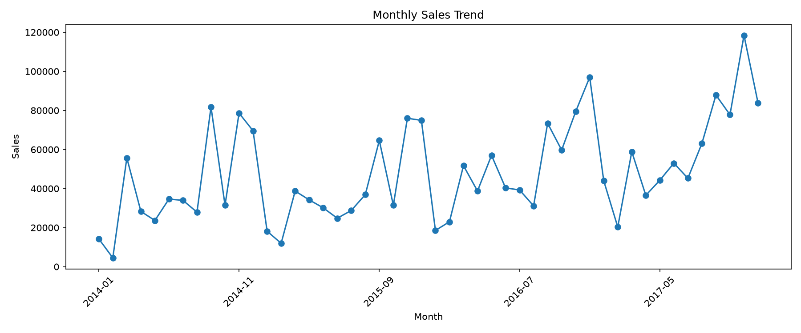
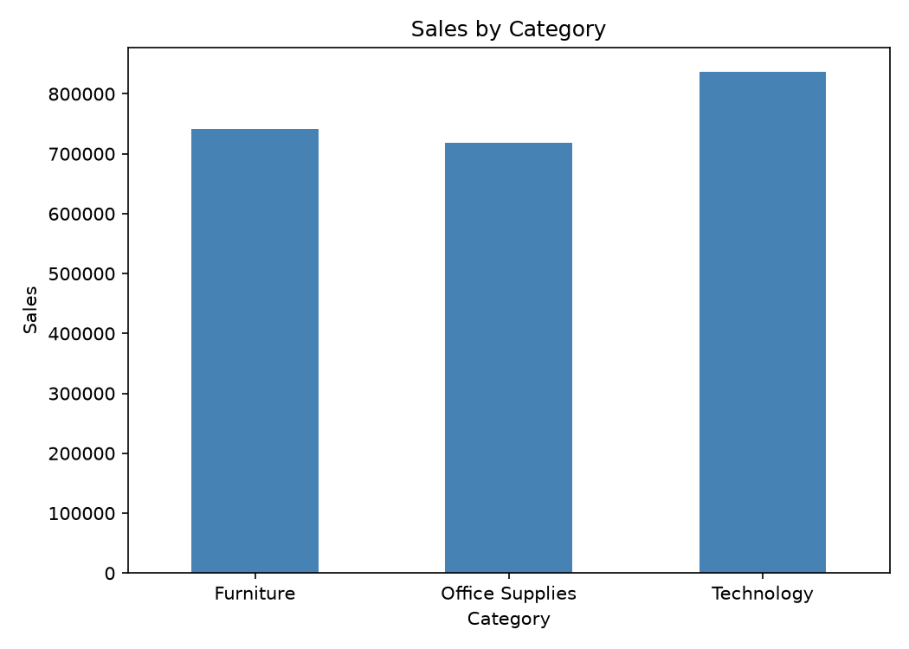
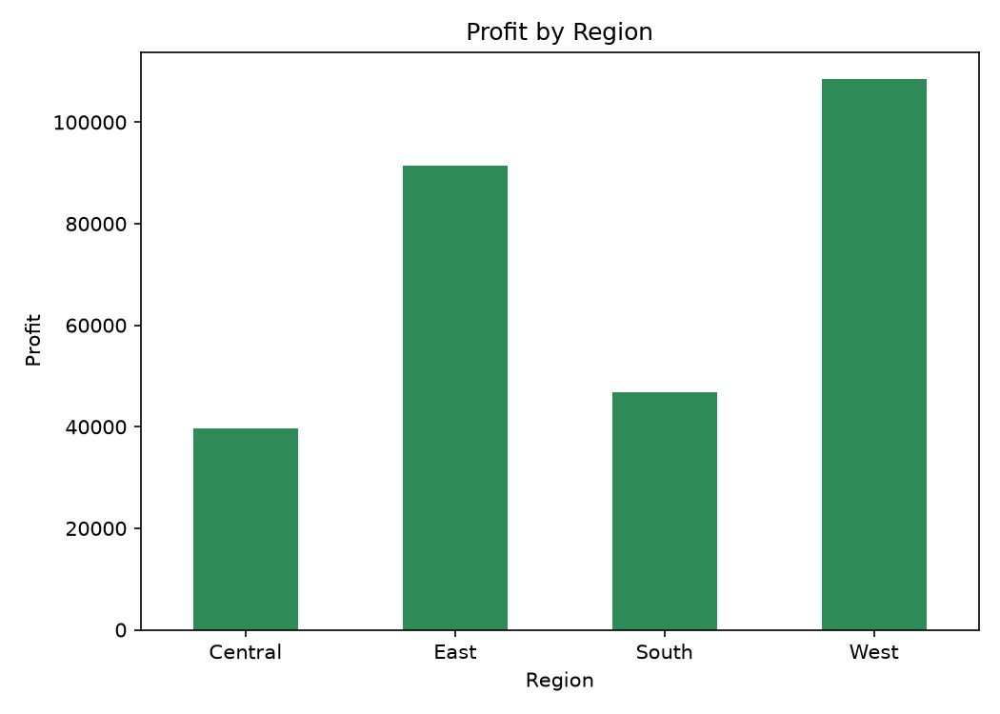
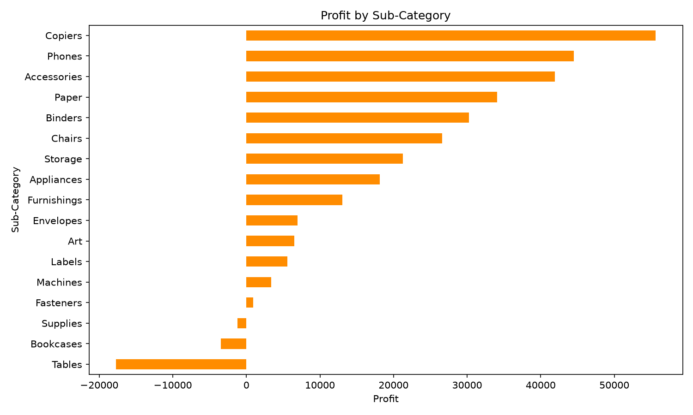
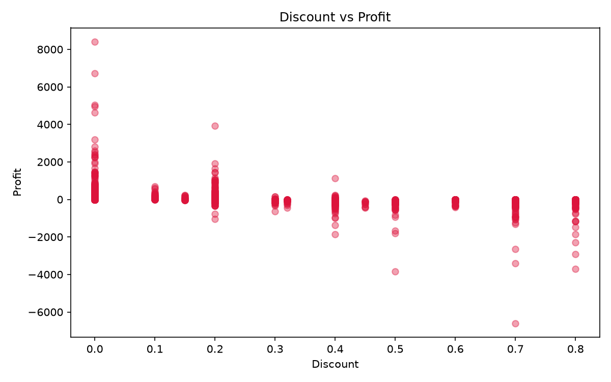

# Retail Sales & Business Performance Analysis Using Python

## Project Overview
This project analyses retail sales data using Python to evaluate business performance, identify profitability trends, understand customer behaviour, and generate management reports.

The objective is to transform raw sales data into meaningful business insights that support data-driven decision-making.

## Business Objectives
- Analyse overall sales and profitability.
- Identify top-performing product categories and products.
- Evaluate region-wise and state-wise business performance.
- Understand the impact of discounts on profitability.
- Analyse monthly and yearly sales trends.
- Identify loss-making products and sub-categories.
- Evaluate customer retention and shipping performance.
- Generate an Excel-based MIS report.

## Dataset Information
- **Dataset:** Sample Superstore
- **Total Records:** 9,994
- **Time Period:** 2014–2017
- **Key Columns:** Order ID, Order Date, Ship Date, Customer Name, Segment, Region, State, Category, Sub-Category, Sales, Quantity, Discount, Profit

## Technologies Used
- Python
- Pandas
- NumPy
- Matplotlib
- Seaborn
- Jupyter Notebook
- Microsoft Excel

## Project Workflow

### 1. Data Understanding
- Loaded the Excel dataset using Pandas.
- Examined dataset structure, columns and data types.
- Analysed numerical data using descriptive statistics.

### 2. Data Quality Checks
- Checked missing values.
- Identified duplicate records.
- Validated sales, quantity, discounts and shipping dates.

### 3. Exploratory Data Analysis (EDA)
- Sales and profit analysis.
- Category and sub-category analysis.
- Regional and state-wise analysis.
- Customer and product performance.
- Monthly and yearly sales analysis.
- Discount impact on profitability.
- Shipping performance analysis.

### 4. Business Performance Analysis
- Year-over-Year (YoY) sales growth.
- Profit margin analysis.
- Customer retention analysis.
- Identification of loss-making products.
- Monthly business performance reporting.

### 5. MIS Reporting
An Excel report (`Reports/Retail_Sales_MIS_Report.xlsx`) containing:
- KPI Summary
- Category Analysis
- Monthly MIS
- State Analysis
- Loss Products

## Key Business Findings

| Metric | Value |
|---|---|
| Total Sales | 2,297,200.86 |
| Total Profit | 286,397.02 |
| Total Orders | 5,009 |
| Total Quantity Sold | 37,873 |
| Overall Profit Margin | ~12.47% |

- **Sales growth:** Yearly sales grew from about $484K (2014) to $733K (2017), an increase of roughly 51%.
- **Technology** is the most profitable category (about $145K profit).
- **Furniture** has high sales (about $742K) but earns only about $18K profit, so margins are weak.
- **West region** is the most profitable region (about $108K profit); **Central** is the weakest (about $40K).
- **Tables** recorded the largest sub-category loss (about -$17.7K).
- **Discounts above 30%** led to a total loss of about $125K, while orders with lower discounts earned about $411K profit.
- **California** generated the highest state-wise sales.

## Visualizations

### Monthly Sales Trend


### Sales by Category


### Profit by Region


### Profit by Sub-Category


### Discount vs Profit


## Recommendations
- **Cap discounts at around 30%.** Heavy discounts turn sales into losses.
- **Review Table pricing and costs,** since this sub-category loses money.
- **Improve Furniture margins** through pricing, supplier cost or discount control.
- **Invest in Technology and the West region,** which drive the most profit.
- **Investigate the Central region,** where profit is lowest.

## Project Structure

```text
Ecommerce_Sales_Analysis/
│
├── Dataset/
│   └── Sample - Superstore.xls
│
├── Notebooks/
│   └── Ecommerce_Sales_Analysis.ipynb
│
├── Reports/
│   └── Retail_Sales_MIS_Report.xlsx
│
├── Visualizations/
│   ├── monthly_sales_trend.png
│   ├── category_sales.png
│   ├── region_profit.png
│   ├── subcategory_profit.png
│   └── discount_profit.png
│
└── README.md
```

## How to Run
1. Clone or download this repository.
2. Install the required libraries:
   ```bash
   pip install pandas numpy matplotlib seaborn xlrd openpyxl jupyter
   ```
3. Open `Notebooks/Ecommerce_Sales_Analysis.ipynb` in Jupyter Notebook.
4. Click **Kernel → Restart & Run All**. The charts are saved in the `Visualizations/` folder.

## Business Value
This project demonstrates practical data analysis skills, including data quality validation, exploratory data analysis, business KPI calculations, data visualization and Excel-based MIS reporting.

The findings help management understand business performance, identify profitability problems and make informed decisions.

## Author
**Subhechha Dhara**
- GitHub: [subhechha93](https://github.com/subhechha93)
- Email: dharasubhechha938@gmail.com
